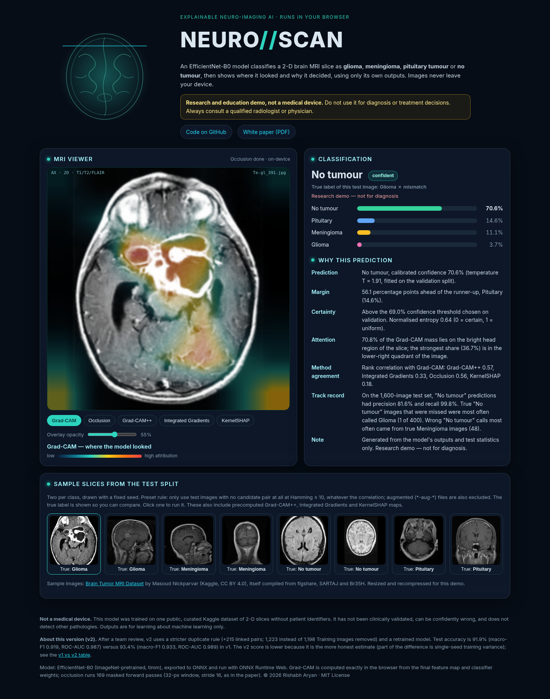

<div align="center">

# Brain Tumour MRI Classification: Leakage-Aware, Calibrated and Explainable EfficientNet-B0

[](https://rishabh-bgp.github.io/brain-tumor-mri-classification/)
[](v2/paper/brain_tumor_mri_white_paper.pdf)
[](documentation/README.md)


**[▶ Live demo: NEURO//SCAN](https://rishabh-bgp.github.io/brain-tumor-mri-classification/)** · **[📄 White paper (PDF)](v2/paper/brain_tumor_mri_white_paper.pdf)** ·
**[📚 Documentation](documentation/README.md)**

</div>

> ⚠️ Research and education project, **not a medical device**. Do not use it for diagnosis or treatment decisions.

Four-way classification of brain MRI slices (glioma, meningioma, pituitary tumour, no tumour) on the Kaggle
[Brain Tumor MRI Dataset](https://www.kaggle.com/datasets/masoudnickparvar/brain-tumor-mri-dataset), with evaluation
hygiene first: a perceptual-hash audit of near-duplicates shared by the official Training and Testing folders, a
leakage-aware split, an EfficientNet-B0 fine-tuned on a CPU, temperature scaling with an "uncertain" flag, six
sanity-checked explanation methods, and an in-browser demo.

By **Rishabh Aryan**, M.Tech (Artificial Intelligence and Data Science), Department of Computer Science and Engineering,
Indian Institute of Information Technology Bhagalpur, Bihar, India.

<p align="center"></p>

## Versions
| Version | Folder | Status | Test accuracy (95% CI) | Macro-F1 |
|---|---|---|---|---|
| **v2** | [`v2/`](v2/README.md) | current; served by the [live demo](https://rishabh-bgp.github.io/brain-tumor-mri-classification/) | 91.9% (90.5%–93.2%) | 0.919 |
| v1 | [`v1/`](v1/README.md) | frozen; code runs at tag [`v1.0`](https://github.com/Rishabh-bgp/brain-tumor-mri-classification/tree/v1.0) | 93.4% (92.1%–94.5%) | 0.933 |

Both on the official Testing folder (n = 1,600). v2 uses a stricter duplicate rule and removes
1,223 instead of 1,198 Training images; it is
preferred because its split is cleaner, not because of its score. The difference in accuracy mainly reflects training
variance of a single seed ([v1 vs v2](documentation/changelog.md)). An identical model trained on the original folders
scores 96.1%; much of that gap appears to come from near-copies of Testing images in its training data.

## Notebooks (v2, Google Colab)
| # | Notebook | Colab |
|---|---|---|
| 1 | [`01_data_and_deduplication.ipynb`](v2/notebooks/01_data_and_deduplication.ipynb) | [](https://colab.research.google.com/github/Rishabh-bgp/brain-tumor-mri-classification/blob/main/v2/notebooks/01_data_and_deduplication.ipynb) |
| 2 | [`02_training_efficientnet_b0.ipynb`](v2/notebooks/02_training_efficientnet_b0.ipynb) | [](https://colab.research.google.com/github/Rishabh-bgp/brain-tumor-mri-classification/blob/main/v2/notebooks/02_training_efficientnet_b0.ipynb) |
| 3 | [`03_evaluation_and_calibration.ipynb`](v2/notebooks/03_evaluation_and_calibration.ipynb) | [](https://colab.research.google.com/github/Rishabh-bgp/brain-tumor-mri-classification/blob/main/v2/notebooks/03_evaluation_and_calibration.ipynb) |
| 4 | [`04_explainable_ai.ipynb`](v2/notebooks/04_explainable_ai.ipynb) | [](https://colab.research.google.com/github/Rishabh-bgp/brain-tumor-mri-classification/blob/main/v2/notebooks/04_explainable_ai.ipynb) |
| 5 | [`05_onnx_export_and_web_demo.ipynb`](v2/notebooks/05_onnx_export_and_web_demo.ipynb) | [](https://colab.research.google.com/github/Rishabh-bgp/brain-tumor-mri-classification/blob/main/v2/notebooks/05_onnx_export_and_web_demo.ipynb) |

Quick start (local): `git clone https://github.com/Rishabh-bgp/brain-tumor-mri-classification.git && cd brain-tumor-mri-classification/v2 && pip install -r requirements.txt`,
then follow the [reproducibility guide](REPRODUCIBILITY.md).

## Documentation
The full documentation is in [`documentation/`](documentation/README.md):

1. [Overview and quick start](documentation/overview.md)
2. [Dataset and data card](documentation/data_card.md)
3. [Duplicate audit and leakage-aware split](documentation/dedup_and_splits.md)
4. [Model and training](documentation/model_and_training.md)
5. [Evaluation and calibration](documentation/evaluation_and_calibration.md)
6. [Explainability](documentation/explainability.md)
7. [Web demo and ONNX export](documentation/web_demo.md)
8. [v1 vs v2 and changelog](documentation/changelog.md)
9. [Reproducibility guide](REPRODUCIBILITY.md)
10. [Repository structure](documentation/repository_structure.md)
11. [Script and API reference](documentation/scripts_reference.md)
12. [Results catalogue](documentation/results_catalogue.md)
13. [Model card](documentation/model_card.md)
14. [Limitations](documentation/limitations.md)
15. [Future work](documentation/future_work.md)
16. [References](documentation/references.md)
17. [FAQ and troubleshooting](documentation/faq.md)

Project files: [CONTRIBUTING](CONTRIBUTING.md) · [Code of conduct](CODE_OF_CONDUCT.md) · [CITATION.cff](CITATION.cff) ·
[references.bib](references.bib) · [LICENSE](LICENSE)

## Repository layout
```text
v2/              current version: src/, scripts/, notebooks/, results/, models/, paper/, README, requirements
v1/              frozen first version (same layout; code runs at tag v1.0)
docs/            GitHub Pages web demo (serves the v2 model)
documentation/   long-form documentation
tests/           tests for the v2 code and the demo
```
Details: [repository structure](documentation/repository_structure.md).

## Limitations
One training seed and CPU training; no external or clinical validation; label noise and possible remaining near-duplicates
in the dataset; confidence intervals that exclude training variance; explanation methods that do not beat a random map on
the deletion test, with Integrated Gradients failing the randomisation sanity check. The preset-image recompression in the
demo was fixed in v2.0.2. Full list: [limitations](documentation/limitations.md).

## Future work
Several seeds, an external test set, patient-level data, stronger duplicate detection, relabelling of conflicting groups,
better uncertainty and out-of-distribution checks, and tumour masks to test explanation localisation:
[future work](documentation/future_work.md).

## References
The white paper's 28 references with DOIs/URLs, plus dataset and software citations, are in
[references](documentation/references.md) and [`references.bib`](references.bib). To cite this project, use
[`CITATION.cff`](CITATION.cff).

## Related projects
**Machine learning and responsible AI**
- [machine-learning-part-1](https://github.com/Rishabh-bgp/machine-learning-part-1): scikit-learn classification and regression notebooks
- [machine-learning-part-2](https://github.com/Rishabh-bgp/machine-learning-part-2): computer vision with YOLO11 (detection, segmentation, pose, leaf disease)
- [machine-learning-part-3](https://github.com/Rishabh-bgp/machine-learning-part-3): YOLO11 road-damage detection with the in-browser [ROAD//SCAN](https://rishabh-bgp.github.io/machine-learning-part-3/) demo
- [responsible-ai-uci-adult](https://github.com/Rishabh-bgp/responsible-ai-uci-adult): responsible-AI audit on UCI Adult with the [FAIR//AUDIT](https://rishabh-bgp.github.io/responsible-ai-uci-adult/) dashboard
- [spam-scan](https://github.com/Rishabh-bgp/spam-scan): explainable spam, phishing and scam detector ([live](https://spam-scan.onrender.com))
- [beed-ml-study](https://github.com/Rishabh-bgp/beed-ml-study): leakage-aware seizure-type benchmark on the Bangalore EEG Epilepsy Dataset
- [pan-cancer-classification](https://github.com/Rishabh-bgp/pan-cancer-classification): leakage, conformal reliability and data efficiency on TCGA Pan-Cancer RNA-Seq

**M.Tech in AI and Data Science, IIIT Bhagalpur**: thesis repositories for *An Investigation into Advanced Techniques for
Wind Speed Forecasting with Applications to Renewable Energy Grid Integration*

- **Quantum and hybrid quantum machine learning**
  - [hybrid-vqc-wind-speed-forecasting](https://github.com/Rishabh-bgp/hybrid-vqc-wind-speed-forecasting): hybrid variational quantum circuit (Conv1D-LSTM + VQC) for wind speed forecasting
  - [cbma-tn-vqc-wind-green-hydrogen](https://github.com/Rishabh-bgp/cbma-tn-vqc-wind-green-hydrogen): reimplementation of CBMA-TN-VQC (CNN-BiLSTM-multi-head attention + tensor network + VQC) for wind forecasting and green hydrogen
  - [hcq-lstm-clqgwo-wind-forecasting](https://github.com/Rishabh-bgp/hcq-lstm-clqgwo-wind-forecasting): reimplementation of a physics-informed hybrid classical-quantum LSTM tuned by a chaotic Lévy-flight quantum-inspired grey wolf optimiser
- **Metaheuristic hybrids**
  - [geoai-hybrid-ga-pso-anfis-wind-forecasting](https://github.com/Rishabh-bgp/geoai-hybrid-ga-pso-anfis-wind-forecasting): GA-PSO-ANFIS-CNN-LSTM hybrid for probabilistic multi-site wind speed forecasting
- **Deep learning with attention and gating**
  - [cnn-bilstm-attention-synthetic-scada](https://github.com/Rishabh-bgp/cnn-bilstm-attention-synthetic-scada): CNN-BiLSTM-attention forecasting on synthetic SCADA data, with baselines
  - [cnn-bilstm-attention-real-scada](https://github.com/Rishabh-bgp/cnn-bilstm-attention-real-scada): CNN-BiLSTM-attention forecasting on wind-turbine SCADA data, with statistical tests
  - [cnn-bilstm-attention-benchmarking-indian-scada](https://github.com/Rishabh-bgp/cnn-bilstm-attention-benchmarking-indian-scada): benchmark of CNN-BiLSTM-attention vs ANN, LSTM, SVM and ARIMA-ANN
  - [xai-shap-lime-cnn-bilstm-attention-wind](https://github.com/Rishabh-bgp/xai-shap-lime-cnn-bilstm-attention-wind): CNN-BiLSTM-attention explained with SHAP, LIME and attention
  - [wind-forecasting-mathematical-formulations-validation](https://github.com/Rishabh-bgp/wind-forecasting-mathematical-formulations-validation): hybrid deep-learning forecasting with Diebold-Mariano and Ljung-Box validation
  - [wuweidl-daoist-gated-wind-forecasting](https://github.com/Rishabh-bgp/wuweidl-daoist-gated-wind-forecasting): WuWeiDL: Daoist-inspired turbulence-gated attention
  - [rso-net-wind-grid-stabilization](https://github.com/Rishabh-bgp/rso-net-wind-grid-stabilization): reimplementation of RSO-Net: TCN-attention probabilistic forecasting with human-approved grid proposals
- **IoT and multi-agent systems**
  - [iot-n8n-wind-turbine-predictive-maintenance](https://github.com/Rishabh-bgp/iot-n8n-wind-turbine-predictive-maintenance): wind-turbine predictive maintenance with IoT data, a FastAPI service and an n8n workflow
  - [multi-agent-turbine-fleet-chief-of-staff](https://github.com/Rishabh-bgp/multi-agent-turbine-fleet-chief-of-staff): multi-agent AI chief of staff for wind-turbine fleet operations
- **Statistical baselines**
  - [arima-sarima-wind-speed-chennai](https://github.com/Rishabh-bgp/arima-sarima-wind-speed-chennai): ARIMA and SARIMA daily wind speed forecasting for Chennai

[All repositories](https://github.com/Rishabh-bgp?tab=repositories) · [Profile](https://github.com/Rishabh-bgp)

## License
[MIT](LICENSE) © 2026 Rishabh Aryan. Dataset © its Kaggle author and source collections (CC BY 4.0); EfficientNet-B0
weights from timm (Apache-2.0); ONNX Runtime Web by Microsoft (MIT); Captum (BSD-3-Clause).
