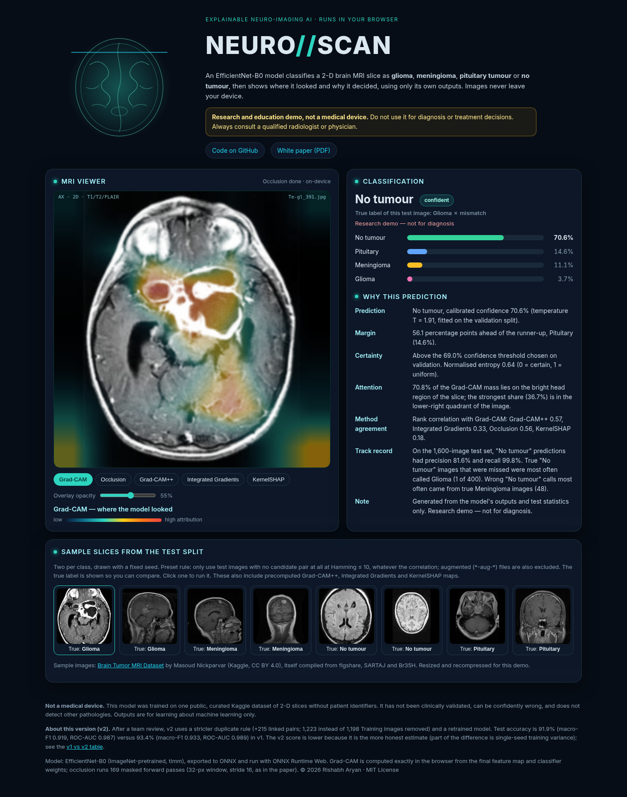
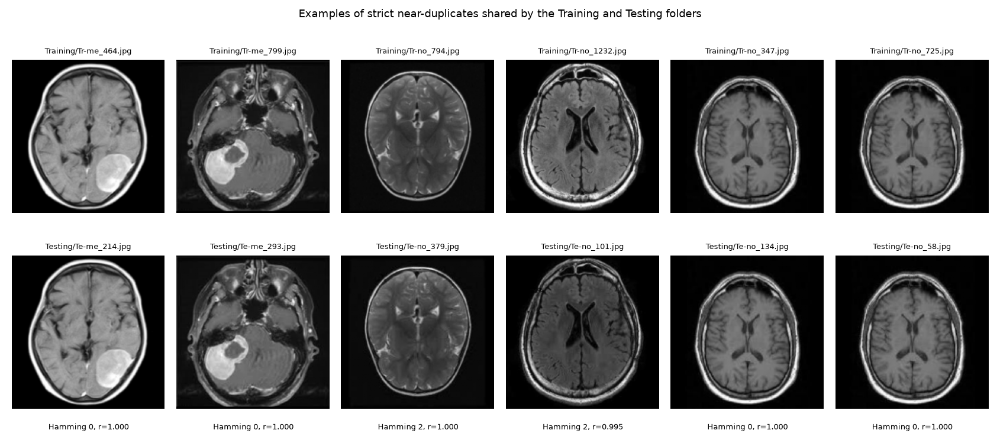
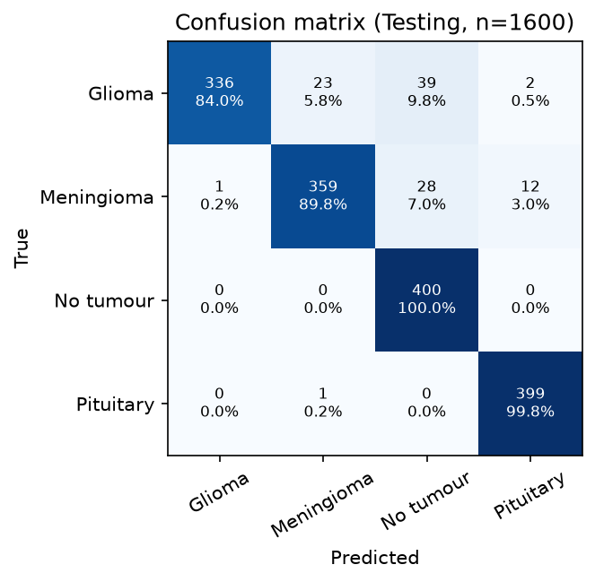
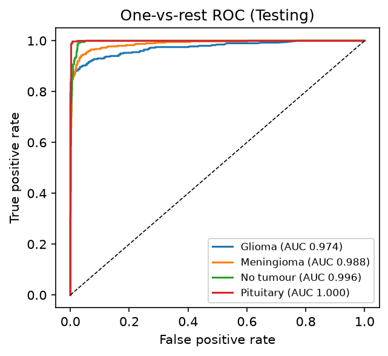
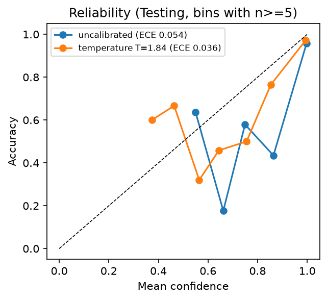
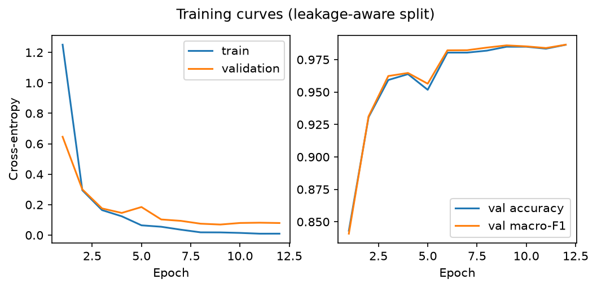
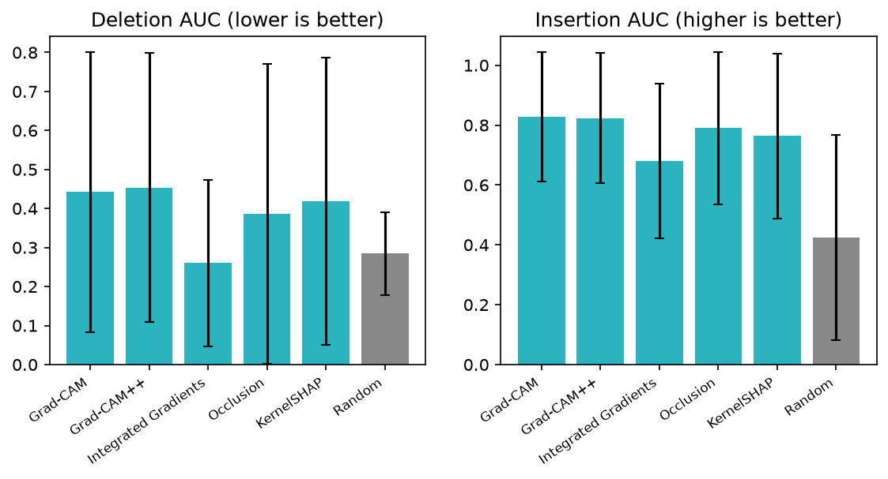
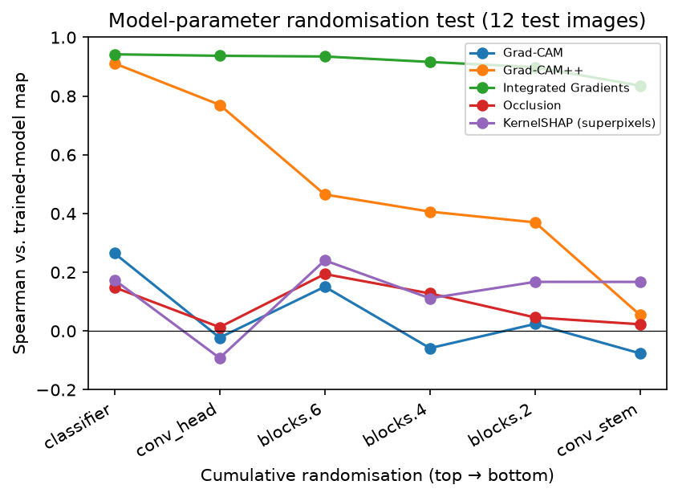
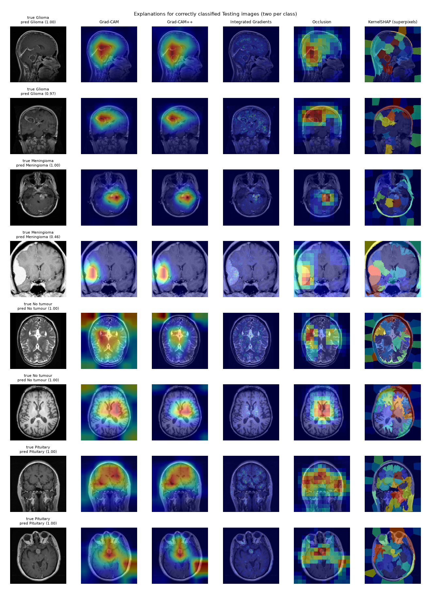
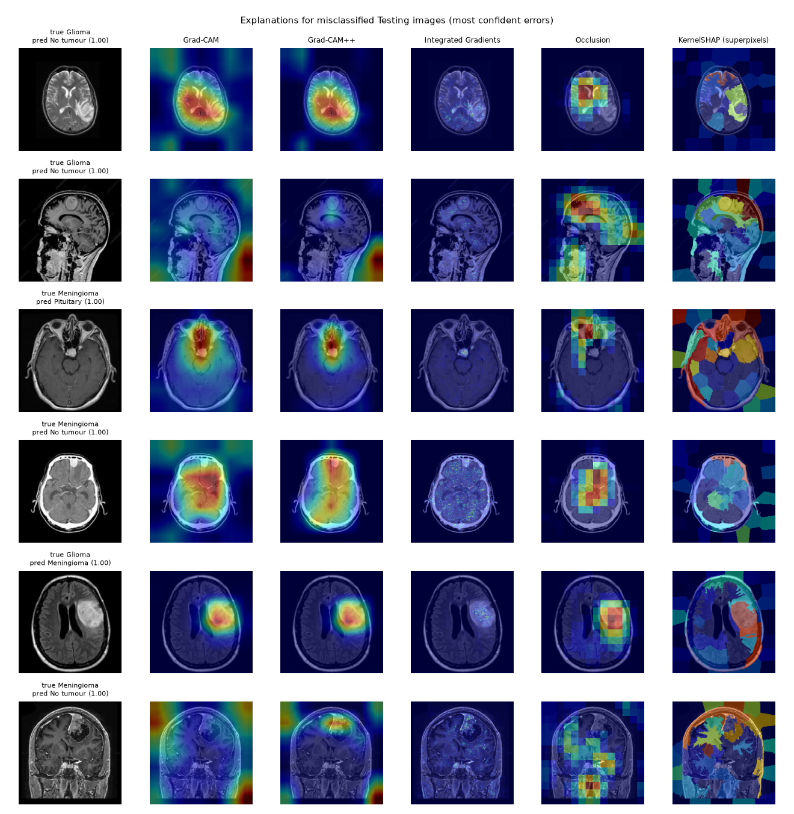

<div align="center">

# Brain Tumour MRI Classification: Leakage-Aware, Calibrated and Explainable EfficientNet-B0


[](https://rishabh-bgp.github.io/brain-tumor-mri-classification/)
[](paper/brain_tumor_mri_white_paper.pdf)


**[▶ Open the live demo: NEURO//SCAN](https://rishabh-bgp.github.io/brain-tumor-mri-classification/)** · **[📄 Read the white paper (PDF)](paper/brain_tumor_mri_white_paper.pdf)**

</div>

> 📦 **This is the frozen v1 of the project** (commit `a591cfa`, tag [`v1.0`](https://github.com/Rishabh-bgp/brain-tumor-mri-classification/tree/v1.0)).
> Its results, notebooks, paper and code are kept here unchanged for comparison; only links were updated for the new
> folder layout. The **current version is [v2](../v2/README.md)**, and the [live demo](https://rishabh-bgp.github.io/brain-tumor-mri-classification/)
> now serves the v2 model (the demo description below is the v1 demo as released). The scripts here expect the v1.0
> layout, so **run the v1 code from a checkout of the `v1.0` tag** (see *How to run*). Overview: [top-level README](../README.md) ·
> [documentation](../documentation/README.md) · [v1 vs v2](../documentation/changelog.md).


> ⚠️ **Research and education project, not a medical device.** The model classifies single 2-D MRI slices from one
> public dataset. It has not been clinically validated, can be confidently wrong, and must not be used for diagnosis
> or treatment decisions.

**Computer vision in PyTorch** for four-way brain MRI classification (**glioma, meningioma, pituitary tumour, no tumour**)
on the Kaggle [Brain Tumor MRI Dataset](https://www.kaggle.com/datasets/masoudnickparvar/brain-tumor-mri-dataset).
The project puts evaluation hygiene first: a perceptual-hash audit finds **near-duplicate images shared by the official
Training and Testing folders**, the training data are de-leaked and split by duplicate group, an ImageNet-pretrained
**EfficientNet-B0** is fine-tuned on a CPU, calibrated with temperature scaling, explained with **five XAI methods**
that are sanity-checked and scored for faithfulness, and served as a static web app where the model runs **in your
browser**.

By **Rishabh Aryan**, M.Tech (Artificial Intelligence and Data Science), Department of Computer Science and Engineering,
Indian Institute of Information Technology Bhagalpur, Bihar, India.

---

## 🧠 Live demo: NEURO//SCAN

<p align="center"></p>

A radiology-workstation-style page: drop an MRI slice (or click one of eight test-split samples labelled with their true
class), watch the scan line sweep while EfficientNet-B0 runs through ONNX Runtime Web (WebAssembly), and read:

- **animated, calibrated class probabilities** for glioma, meningioma, pituitary and no tumour;
- a **heat overlay with an opacity slider** and a method toggle: **Grad-CAM** (exact, computed from the ONNX feature map and classifier weights), **occlusion** (49 masked forward passes in the browser), and for the samples precomputed **Grad-CAM++, Integrated Gradients and KernelSHAP**;
- a **"Why this prediction" panel** built from templates filled only with measured quantities: calibrated confidence, margin over the runner-up, an *uncertain — low confidence* flag, entropy, where the Grad-CAM mass falls, agreement between XAI methods (samples), and the class's real test precision/recall and most common confusion. It contains no medical reasoning.

Images never leave your device. Mobile layout: [screenshot](https://github.com/Rishabh-bgp/brain-tumor-mri-classification/blob/v1.0/docs/screenshot_mobile.png).

## 📚 Notebooks (run on Google Colab)

| # | Notebook | What it does | Colab |
|---|---|---|---|
| 1 | [01_data_and_deduplication.ipynb](notebooks/01_data_and_deduplication.ipynb) | `kagglehub` download, inspection, MD5 + pHash + correlation duplicate audit, leakage-aware split | [](https://colab.research.google.com/github/Rishabh-bgp/brain-tumor-mri-classification/blob/main/v1/notebooks/01_data_and_deduplication.ipynb) |
| 2 | [02_training_efficientnet_b0.ipynb](notebooks/02_training_efficientnet_b0.ipynb) | EfficientNet-B0 fine-tuning, leakage-aware and naive runs, training curves | [](https://colab.research.google.com/github/Rishabh-bgp/brain-tumor-mri-classification/blob/main/v1/notebooks/02_training_efficientnet_b0.ipynb) |
| 3 | [03_evaluation_and_calibration.ipynb](notebooks/03_evaluation_and_calibration.ipynb) | Prediction file, temperature scaling, uncertainty threshold, metrics with bootstrap CIs, confusion matrix, ROC, leakage comparison | [](https://colab.research.google.com/github/Rishabh-bgp/brain-tumor-mri-classification/blob/main/v1/notebooks/03_evaluation_and_calibration.ipynb) |
| 4 | [04_explainable_ai.ipynb](notebooks/04_explainable_ai.ipynb) | Grad-CAM, Grad-CAM++, Integrated Gradients, occlusion, KernelSHAP; randomisation sanity check; deletion/insertion AUC; per-class and error grids | [](https://colab.research.google.com/github/Rishabh-bgp/brain-tumor-mri-classification/blob/main/v1/notebooks/04_explainable_ai.ipynb) |
| 5 | [05_onnx_export_and_web_demo.ipynb](notebooks/05_onnx_export_and_web_demo.ipynb) | ONNX export (logits + CAM), PyTorch/ONNX agreement check | [](https://colab.research.google.com/github/Rishabh-bgp/brain-tumor-mri-classification/blob/main/v1/notebooks/05_onnx_export_and_web_demo.ipynb) |

Each notebook installs its dependencies on Colab, checks for a GPU, clones this repository for the `src/` package and
downloads the dataset with `kagglehub` (public dataset, no API key needed). The committed notebooks keep their executed
outputs. Notebooks 2 and 4 reuse the committed checkpoint and XAI results unless you set `FORCE_TRAIN` / `FORCE_XAI = True`.

## 🔍 Duplicate audit (the dataset's hidden leakage)

Version 2 of the dataset states that duplicates were removed and train/test overlap eliminated. At the **file** level that
is true: none of the 340 byte-identical files (7,013 unique MD5s among 7,200) crosses the folders. At the
**image** level it is not:

| Check | Result |
|---|---|
| Strict near-duplicate pairs (pHash Hamming ≤ 2 and 64×64 thumbnail correlation ≥ 0.98) | 3,484 pairs, **1,270 across Training/Testing** |
| Linked pairs (MD5 equal, or Hamming ≤ 6 and correlation ≥ 0.95) | 5,962 pairs, 2,158 across |
| Testing images with a strict near-duplicate in Training | **441 / 1,600 (27.6%)**: no tumour 327, meningioma 105, glioma 9, pituitary 0 |
| Testing images linked to a Training image | 620 / 1,600 (38.8%) |
| Images in groups carrying two different labels | 13 |

**Leakage-aware split:** every Training image linked to a Testing image (1,198, of which 836 are no-tumour) and every
label-conflict image is removed; the rest is split into **3,739 train / 663 validation** images *by duplicate group*.
The official 1,600 Testing images are kept intact, so no linked copy of any test image is seen in training.
Thresholds were chosen by visual inspection; all hashes and candidate pairs are released for re-analysis.

<p align="center"></p>

## 📈 Results (from the saved prediction file)

EfficientNet-B0 (ImageNet-pretrained, 4.0 M parameters), 224 px greyscale, 12 epochs on an 8-core CPU, seed 42.
Every number below, the white paper's tables and the demo's statistics are generated by scripts from
`results/predictions/clean_test_predictions.csv`.

**Leakage-aware model, full Testing folder (n = 1,600):** accuracy **93.4%** (95% bootstrap CI 92.1%–94.5%),
macro-F1 **0.933**, macro one-vs-rest ROC-AUC **0.989**, ECE 0.054 → **0.036** after temperature scaling (T = 1.84).
One image per duplicate group (n = 1,347): accuracy 93.1%, macro-F1 0.926.

| Class | Precision | Recall | F1 | ROC-AUC |
|---|---|---|---|---|
| Glioma | 0.997 | 0.840 | 0.912 | 0.974 |
| Meningioma | 0.937 | 0.897 | 0.917 | 0.988 |
| No tumour | 0.857 | 1.000 | 0.923 | 0.996 |
| Pituitary | 0.966 | 0.998 | 0.982 | 1.000 |
| **Macro** | | | **0.933** | **0.989** |

The dominant error is a tumour called *no tumour* (39 gliomas, 28 meningiomas): no-tumour recall is perfect but its
precision is 85.7%. Validation accuracy inside the training distribution is 98.6%, well above test accuracy, which
suggests a shift between the Training and Testing folders beyond the duplicates removed.

**Naive vs leakage-aware.** An identical model trained on the original Training folder (random image-level validation split) scores **96.1%** on the same Testing folder, 2.8 points higher. Part of the gap may come from more training data (4,760 vs 3,739 training images; 1,190 vs 478 no-tumour), but the per-class split shows memorisation: on the 105 Testing meningiomas that have a strict near-duplicate in Training the naive model is correct on **105/105**, the leakage-aware model on 74/105, while on the 295 meningiomas without one the two are close (288 vs 285 correct). Headline accuracies on this dataset that train on the original Training folder are therefore partly a measure of recall of near-copies.

| Model | Full Testing | Testing with a strict dup. in Training (n = 441) | Testing with no linked dup. (n = 980) |
|---|---|---|---|
| Leakage-aware | 93.4% | 92.5% | 92.7% |
| Naive (original Training folder) | 96.1% | 99.5% | 94.1% |

**Uncertainty threshold.** A prediction is flagged *uncertain — low confidence* when its calibrated confidence is below
**τ = 0.67**, the smallest value in {0.50, 0.51, …, 0.99} at which retained validation predictions reach ≥ 99% accuracy
(validation coverage 98.5%). On Testing, 3.8% of predictions are flagged; accuracy is 95.3% on confident and
44.3% on flagged predictions. Normalised entropy is displayed but not thresholded.

<table>
  <tr>
    <td align="center" width="50%"><br><sub>Confusion matrix (Testing)</sub></td>
    <td align="center" width="50%"><br><sub>One-vs-rest ROC curves</sub></td>
  </tr>
  <tr>
    <td align="center" width="50%"><br><sub>Calibration before/after temperature scaling</sub></td>
    <td align="center" width="50%"><br><sub>Training curves (leakage-aware split)</sub></td>
  </tr>
</table>

## 🔬 Explainable AI

Five attribution methods for the predicted class: **Grad-CAM**, **Grad-CAM++**, **Integrated Gradients** (Captum, 32 steps,
black baseline), **occlusion** (32-px patch, stride 16) and **KernelSHAP** on ~64 SLIC superpixels (200 coalitions).
Evaluated on 100 test images (25 per class) with **deletion/insertion AUC** (Petsiuk et al., 2018) against a random
baseline, and on 12 images with the **cascading model-parameter randomisation test** (Adebayo et al., 2018).

| Method | Deletion AUC ↓ | Insertion AUC ↑ | Mass on head region | ρ after classifier randomised | ρ after full randomisation |
|---|---|---|---|---|---|
| Grad-CAM | 0.442 ± 0.359 | 0.828 ± 0.215 | 76.3% | 0.26 | -0.08 |
| Grad-CAM++ | 0.454 ± 0.346 | 0.823 ± 0.217 | 81.8% | 0.91 | 0.05 |
| Integrated Gradients | 0.260 ± 0.213 | 0.680 ± 0.259 | 97.7% | 0.94 | 0.84 |
| Occlusion | 0.387 ± 0.385 | 0.790 ± 0.254 | 83.3% | 0.15 | 0.02 |
| KernelSHAP (SLIC) | 0.419 ± 0.369 | 0.764 ± 0.276 | 73.4% | 0.17 | 0.17 |
| Random baseline | 0.285 ± 0.106 | 0.424 ± 0.342 | 57.9% | — | — |

**What the numbers say.**
- **Insertion** separates the methods from the random baseline (0.424): Grad-CAM 0.828, Grad-CAM++ 0.823, occlusion 0.790, KernelSHAP 0.764, Integrated Gradients 0.680.
- **Deletion** (black fill) does not: only Integrated Gradients (0.260) beats random (0.285). Scattered black pixels push slices out of distribution faster than deleting one compact region, so this metric favours pixel-scattered maps under a black baseline.
- **Sanity check:** randomising only the classifier drops the rank correlation to 0.26 (Grad-CAM), 0.15 (occlusion) and 0.17 (KernelSHAP): these maps depend on what the model learned. Grad-CAM++ stays at 0.91 until deeper blocks are randomised, and **Integrated Gradients fails** (0.84 even after the whole network is re-initialised), so its good deletion score is not evidence of faithfulness.
- **Agreement** between methods is moderate: Grad-CAM vs Grad-CAM++ 0.80, vs occlusion 0.43, vs Integrated Gradients 0.41, vs KernelSHAP 0.19.
- In several confident errors (gliomas called *no tumour*) the maps sit on the ventricles or outside the brain rather than on the visible lesion.

The demo therefore uses **Grad-CAM** (passes the sanity check, best insertion) by default, with **occlusion** as a model-agnostic cross-check.

<table>
  <tr>
    <td align="center" width="50%"><br><sub>Faithfulness: deletion (↓) and insertion (↑) AUC</sub></td>
    <td align="center" width="50%"><br><sub>Sanity check: cascading randomisation</sub></td>
  </tr>
</table>
<p align="center"><br><sub>Correctly classified test slices, two per class</sub></p>
<p align="center"><br><sub>The most confident errors</sub></p>

## 📄 White paper

[`paper/brain_tumor_mri_white_paper.pdf`](paper/brain_tumor_mri_white_paper.pdf) (LaTeX source `paper/brain_tumor_mri_white_paper.tex`,
references `paper/references.bib`, auto-generated numbers `paper/numbers.tex` and tables `paper/tables/`). Sections: abstract,
introduction, related work, data and duplicate audit, method, results, explainability, in-browser demonstrator,
limitations, ethics and conclusion. All citations were checked against Crossref or arXiv.

## 🗂️ Data

[Brain Tumor MRI Dataset](https://www.kaggle.com/datasets/masoudnickparvar/brain-tumor-mri-dataset) by **Masoud Nickparvar**
(Kaggle, version 2, **CC BY 4.0**), compiled from figshare (Cheng et al., 2015), SARTAJ and Br35H: 7,200 slices,
Training 4 × 1,400, Testing 4 × 400. The dataset is **not** committed; it is downloaded at run time:

```python
import kagglehub

# Download latest version
path = kagglehub.dataset_download("masoudnickparvar/brain-tumor-mri-dataset")

print("Path to dataset files:", path)
```
The eight demo samples in `docs/samples/` are resized Testing images (two per class, seeded) that belong to no strict or
linked duplicate pair anywhere in the dataset, redistributed under CC BY 4.0 with attribution.

## 🧾 Review files (`results/review/`)

| File | Contents |
|---|---|
| `train_files.csv`, `val_files.csv`, `test_files.csv`, `excluded_files.csv` | The exact split used (relative path, class, label) |
| `hashes_and_groups.csv` | MD5, 64-bit pHash, duplicate group, subset and leakage flags for all 7,200 images |
| `duplicate_pairs.csv` | Every strict or linked pair with Hamming distance, thumbnail correlation and cross-split/label-conflict flags |
| `candidate_pairs_hamming_le10.csv.gz` | All pairs within Hamming 10, for re-analysis with other thresholds |
| `dedup_summary.json` | Audit counts |
| `test_predictions.csv` | Raw per-image test predictions: path, true, predicted, calibrated and raw class probabilities, confidence, entropy, uncertain flag, duplicate flags |

## 🚀 How to run

```bash
git clone --branch v1.0 https://github.com/Rishabh-bgp/brain-tumor-mri-classification.git   # v1 code = tag v1.0
cd brain-tumor-mri-classification
python -m venv .venv && source .venv/bin/activate
pip install -r requirements.txt
python scripts/build_splits.py                       # hash audit + split files
cd src && python -m btmri.train --run clean && python -m btmri.train --run naive && cd ..
python scripts/make_predictions.py                   # single source of truth
python scripts/make_report.py                        # metrics, tables, figures, docs/stats.json
python scripts/run_xai.py && python scripts/make_presets.py
python scripts/export_onnx.py                        # docs/model/*.onnx
python scripts/make_paper_numbers.py && cd paper && tectonic brain_tumor_mri_white_paper.tex
pytest -q tests && node tests/test_logic.js
```
Use the trained model directly:
```python
import torch, sys; sys.path.insert(0, "src")
from btmri.model import build_model, to_input
from btmri.data import load_gray_square
m = build_model(pretrained=False); m.load_state_dict(torch.load("models/brain_tumor_effnetb0.pt", map_location="cpu")); m.eval()
x = torch.from_numpy(load_gray_square("slice.jpg", 224))[None]
print(torch.softmax(m(to_input(x)) / 1.84, 1))   # glioma, meningioma, notumor, pituitary
```
Run the v1 web demo locally from the `v1.0` checkout: `cd docs && python -m http.server 8000`, then open http://localhost:8000.

## 📁 Repository layout (at tag `v1.0`)
```
src/btmri/   data, dedup, splits, model, train, calibrate, xai
scripts/     build_splits, make_predictions, make_report, run_xai, make_presets, export_onnx, make_paper_numbers, figures
notebooks/   five executed, Colab-ready notebooks
results/     predictions/, review/, runs/ (histories, logits, naive checkpoint), xai/, figures/, metrics.json
models/      brain_tumor_effnetb0.pt (PyTorch) and brain_tumor_effnetb0.onnx
docs/        NEURO//SCAN web app on GitHub Pages (index.html, style.css, logic.js, app.js, model/, samples/, stats.json, presets.json)
paper/       white paper PDF, LaTeX source, bibliography, generated numbers and tables
tests/       pytest (hashing, calibration, split integrity) and a Node test for the demo logic
```

## ⚠️ Limitations
No patient identifiers (other slices of a patient may still cross the split) · duplicate thresholds set by inspection ·
no-tumour images come from a different source collection (possible source shortcut) · single 2-D slice, four labels ·
one training seed per configuration · no lesion masks, so explanations cannot be checked for localisation.

## 🔗 More projects
- [Machine Learning Part 3](https://github.com/Rishabh-bgp/machine-learning-part-3): road damage detection with YOLO11 · [ROAD//SCAN](https://rishabh-bgp.github.io/machine-learning-part-3/)
- [Machine Learning Part 2](https://github.com/Rishabh-bgp/machine-learning-part-2): YOLO11 task tour & potato leaf disease classification
- [Machine Learning Part 1](https://github.com/Rishabh-bgp/machine-learning-part-1): heart-disease classification & insurance-cost regression
- [Responsible AI on UCI Adult](https://github.com/Rishabh-bgp/responsible-ai-uci-adult): fairness, explainability & governance audit · [FAIR//AUDIT](https://rishabh-bgp.github.io/responsible-ai-uci-adult/)
- [beed-ml-study](https://github.com/Rishabh-bgp/beed-ml-study) and [pan-cancer-classification](https://github.com/Rishabh-bgp/pan-cancer-classification): more leakage-aware biomedical ML
- [All repositories](https://github.com/Rishabh-bgp?tab=repositories) · [Profile](https://github.com/Rishabh-bgp)

## 📄 License
[MIT](../LICENSE) © 2026 Rishabh Aryan. Dataset © its Kaggle author and source collections (CC BY 4.0); EfficientNet-B0
weights from timm (Apache-2.0); ONNX Runtime Web by Microsoft (MIT); Captum (BSD-3-Clause).
